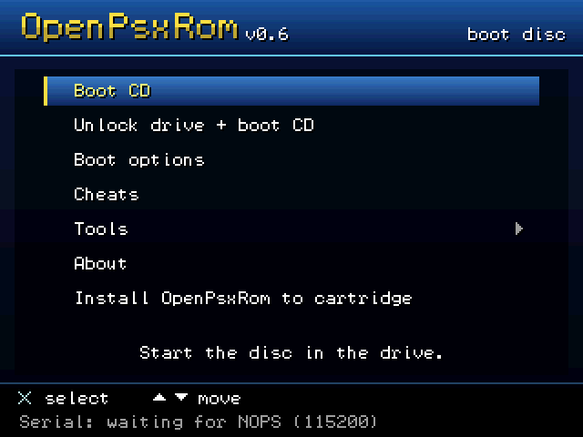
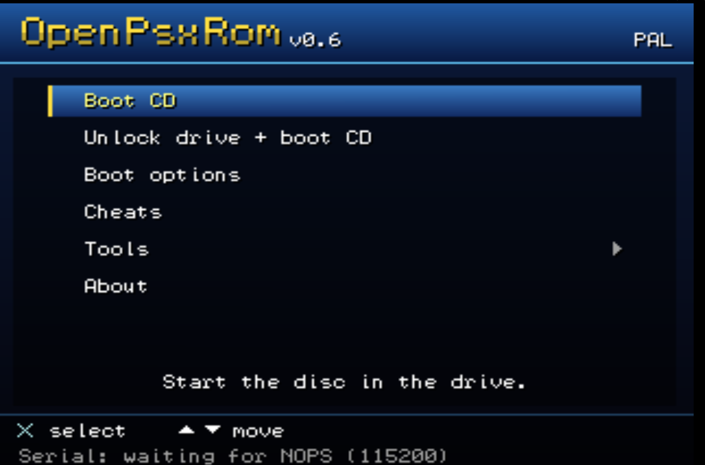
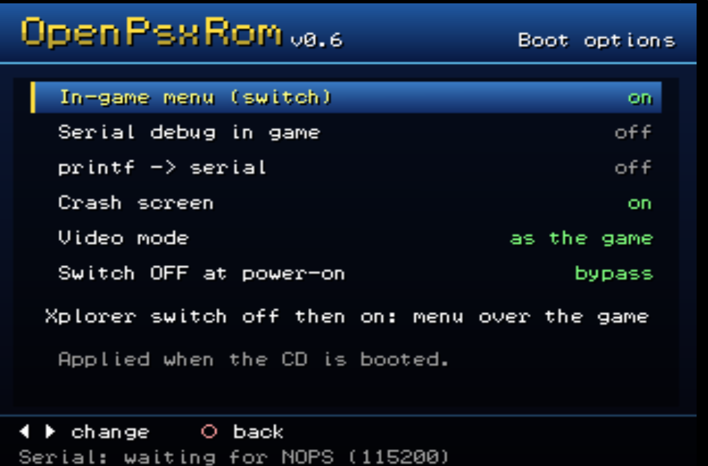
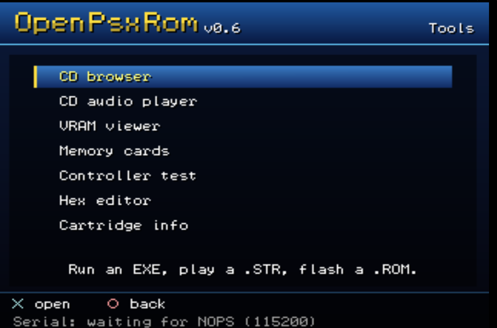
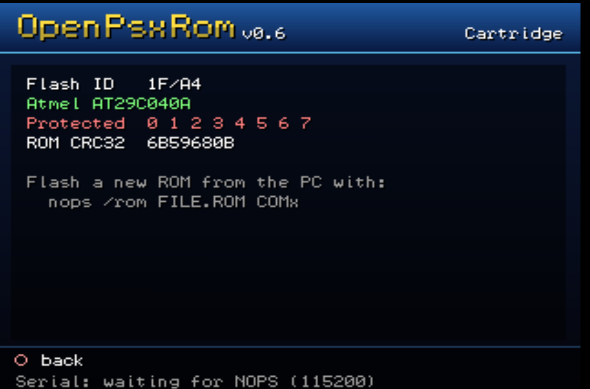

# OpenPsxRom

Open-source firmware for PlayStation 1 cheat cartridges (Xplorer, Action Replay…).

OpenPsxRom replaces the firmware of a parallel-port cheat cartridge with a free one: a menu to
boot discs, cheats applied while the game runs, an in-game menu, memory card tools with compressed
saves kept in the cartridge, and the development features of [Unirom](https://github.com/JonathanDotCel/unirom8_bootdisc_and_firmware_for_ps1),
through the same serial protocol, so the existing `nops` tool works with it.



*On a real PlayStation, captured over the serial port with `tools/psxshot.py` (no TV needed).*

| | |
|---|---|
|  |  |
|  |  |

## Highlights

- **Everything fits in 128 KB**: the whole firmware (menu, graphics, font, CD and memory card
  drivers, serial protocol, debug core, STR decoder) is a 64 KB LZSS-compressed image, unpacked to
  RAM at boot. The other 64 KB of the first bank hold the saves, the cheats and the settings.
- **Compressed memory card saves in the cartridge**: copy saves file by file between the memory
  card and the cartridge flash, with icons. They are stored compressed (OMC1 LZSS in an OFS1
  container): saves are mostly empty space, so the 48 KB area holds far more than 48 KB of saves.
  `tools/omc.py` packs/unpacks these images and exports `.mcs` files on the PC.
- **Several firmwares in one cartridge**: on 256 KB+ cartridges the Xplorer switch can start a
  second firmware (bank 2, e.g. Unirom "ROM2") or a third one on double-chip Xplorer FX (bank 3),
  chosen in the menu; `/rom` installs an image in the right bank without touching OpenPsxRom.
- **Safe flashing**: Sony header and checksum checked before writing, page-by-page programming
  with read-back verification, identical pages skipped, memory card frames read back after writing.
- **`nops` compatible**, so existing Unirom workflows (upload, dump, debug, PCDRV) keep working.

## Features

**Menu**
- Boot CD, or unlock the drive and boot (burned discs, no modchip)
- Boot options: in-game menu, serial debug, printf to serial, crash screen, video mode
  (as the game / force PAL / force NTSC)
- Cheats (GameShark format), stored in the cartridge flash, applied on every interrupt
- Tools: CD browser (run an EXE, flash a .ROM, play an .STR), CD audio player, VRAM viewer,
  memory card manager (two panes: memory card / cartridge, with animated icons), controller test,
  hex editor, cartridge info
- Detailed boot log on the serial port (BIOS, flash chips, switch, pads, memory cards, CD)

**While a game runs** (small resident core at 8000C000h + code executed from the cartridge ROM)
- In-game menu: Xplorer switch off then on (cheats on/off, code finder)
- Code finder (search RAM values, narrow down, turn results into cheats)
- printf/TTY to the serial port, crash screen with registers
- Remote debugging with `nops` (`/debug`, dump, memory writes, halt/continue, breakpoints)
- PCDRV (host file access from the PS1 through `nops /m`)

**Serial protocol**: compatible with `nops` (Unirom 8): `/ping`, `/bin`, `/exe`, `/rom`, `/jump`,
`/dump`, `/mcup`, `/mcdown`, `/debug`, `/psxbaud`…

**Xplorer switch and flash banks**
- Switch ON: OpenPsxRom starts.
- Switch OFF: by default the cartridge stays invisible (normal boot). It can instead start a second
  firmware in bank 2 (1F020000h, e.g. Unirom "ROM2") or bank 3 (1F040000h, double-chip carts).
  Chosen in *Boot options*, stored in the flash, checked before jumping (header + entry inside the bank).
- `/rom` detects which bank an image is built for and writes it there without touching OpenPsxRom.

## Supported hardware

| Cartridge | Flash | Notes |
|---|---|---|
| Xplorer / Xploder V1–V3, Classic, Pro | SST 29EE020 (256 KB) | tested: OpenPsxRom in bank 1, a second firmware in bank 2 |
| Xplorer FX, double chip | 2 × SST 29EE020 | second chip at 1F040000h; 384 KB addressable (the Xplorer registers sit at 1F060000h) |
| Datel (Action Replay / PS Hacker) | AMD Am29F010 (128 KB) | one bank; some sectors may be hardware-protected |

Known chips: AMD Am29F010, ST M29F010B, Fujitsu MBM29F010, SST 39SF010A/020A/040,
SST 29EE010/29EE020/29LE020, Atmel AT29C010A/020/040A, Winbond W29EE011. Unknown chips are
reported with their ID in the boot log.

**Flash layout (bank 1)**

| Offset | Size | Content |
|---|---|---|
| 00000h | 64 KB | OpenPsxRom (code compressed with a small LZSS) |
| 10000h | 48 KB | memory card saves, compressed (OFS1/OMC1 container) |
| 1C000h | 16 KB | cheat list (`OCH1`), settings page at 1FF80h (`OCF1`) |
| 20000h | 128 KB | bank 2: optional second firmware |

## Building

Requirements: a `mipsel-none-elf` GCC toolchain and Python 3.

```
make TOOLS=/path/to/mipsel-none-elf-        # build/openrom.rom  (cartridge image, 128 KB)
make lo TOOLS=...                           # build/openrom_lo.exe (same menu as a RAM EXE)
make disc TOOLS=...                         # release/openrom.bin/.cue (boot disc with installer)
```

## Installing

From a running OpenPsxRom or Unirom (not in debug mode):

```
nops /rom build/openrom.rom /dest COMx
```

The image is checked (Sony header, checksum), written page by page and verified.
To reflash a cartridge that does not boot: start the console from the Unirom or OpenPsxRom boot
disc without the cartridge, insert it, then run `nops /rom`.

Keep a dump of your original firmware first: `nops /dump 0x1F000000 0x40000 backup.bin`.

## Debugging

All commands use [`nops`](https://github.com/JonathanDotCel/unirom8_bootdisc_and_firmware_for_ps1)
v18 (`/dest COMx`; older builds take the port as last argument). The serial line is SIO1 at
115200 bauds, 8N1 (`/psxbaud 230400` for twice the speed with USB adapters that cannot do 518400).

**Boot log.** Open a terminal on the port at 115200 and reset the console: OpenPsxRom prints the
BIOS version, the flash chip(s) and their IDs, the switch and bank settings, pads, memory cards, CD.

**Load and run code** (from the OpenPsxRom menu):
```
nops /exe program.exe /dest COMx          # upload a PS-EXE and start it
nops /bin 0x80100000 data.bin /dest COMx   # upload raw data to RAM
nops /jump 0x80100000 /dest COMx           # jump to an address
nops /dump 0x80010000 0x1000 out.bin /dest COMx   # read RAM, ROM or the cartridge (1F000000h)
```

**Debug a game or program while it runs**:
```
nops /debug /dest COMx                     # install the resident debug core
nops /exe program.exe /m /dest COMx        # start it and watch its printf output (monitor)
```
With the debug core (or the *Serial debug in game* / *printf -> serial* boot options for a CD):
printf/TTY output goes to the serial port, `/dump` and uploads work while the program runs, a crash
shows the registers on screen and on the serial port, `break` instructions halt the program
(GDB-style software breakpoints) and **PCDRV** gives it access to the PC's files through `nops /m`
(`break 0x101-0x107`, PSn00bSDK and Sony SDK encodings).

**Screenshot of the PS1 screen** (no TV needed):
```
python tools/psxshot.py screen.png --port COMx --nops path/to/nops.exe
python tools/psxshot.py vram.png --rect 0 0 1024 512 --scale 1 ...   # the whole VRAM
```
OpenPsxRom copies the picture to RAM with its `SHOT` command, the script fetches it with
`nops /dump` and writes a PNG (needs pyserial and Pillow). Works while the OpenPsxRom menu runs.

**Memory cards**:
```
nops /mcdown 0 card.mcr /dest COMx         # read the card in slot 1 (raw 128 KB)
nops /mcup 0 card.mcr /dest COMx           # write it (every frame verified by reading it back)
```

**Emulator**: `tools/run_duck.ps1` boots `build/openrom.rom` in a DuckStation copy configured
for Xplorer cartridge emulation and prints the TTY log; `tools/shot.ps1` captures its window.

## Status

Tested on real hardware: boot, menu over serial, `nops` commands (`/ping`, `/bin`, `/exe`, `/rom`,
`/dump`, `/mcup`, `/mcdown`, `/debug`, 230400 baud), flashing an SST 29EE020, switch / bank 2,
second-chip detection, memory card writes with read-back verification, screenshots over serial.

Not yet tested on hardware: in-game menu, cheats, code finder, card manager, CD audio, STR player,
PCDRV, GDB breakpoints.

## Credits and license

OpenPsxRom — Copyright (C) 2026 embarquech.
Licensed under the GNU General Public License v3.0 or later, see [LICENSE](LICENSE).

- `src/str/`: MDEC/VLC decoder from [PSn00bSDK](https://github.com/Lameguy64/PSn00bSDK)
  by spicyjpeg, MPL-2.0 (license notices kept in the files).
- Serial protocol compatible with Unirom / NoPS by JonathanDotCel and contributors.
- Hardware details: [psx-spx](https://psx-spx.consoledev.net/) (Martin Korth / no$psx) and the psxdev.net community.

This project is not affiliated with Sony, FCD/Blaze or Datel. No proprietary firmware or BIOS is included.
