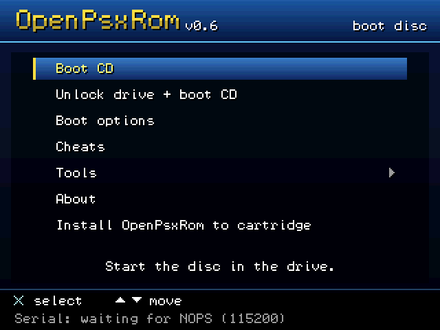

OpenPsxRom
==========

Open-source firmware for PlayStation 1 cheat cartridges (Xplorer, Action Replay...).

OpenPsxRom replaces the firmware of a parallel-port cheat cartridge with a free one: a menu to boot
discs, cheats applied while the game runs, an in-game menu, memory card tools with compressed saves
kept in the cartridge, several firmwares on one cartridge, and the development features of Unirom
through the same serial protocol, so the existing ``nops`` tool works with it.

   OpenPsxRom on a real PlayStation, captured over the serial port with ``tools/psxshot.py``.

.. toctree::
   :maxdepth: 2
   :caption: User guide

   overview
   hardware
   installing
   menu

.. toctree::
   :maxdepth: 2
   :caption: Development

   debugging
   protocol
   formats
   internals
   testing
   status

Source code: https://github.com/embarquech/OpenPsxRom (GPL-3.0-or-later).
