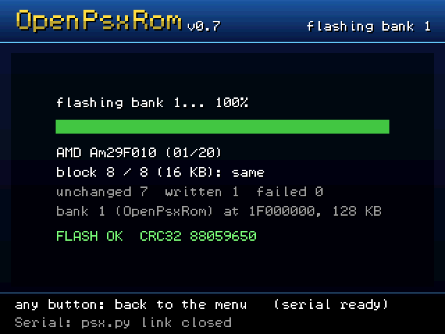

Building and installing
=======================

Building
--------

Requirements: a ``mipsel-none-elf`` GCC toolchain and Python 3.

.. code-block:: sh

   make TOOLS=/path/to/mipsel-none-elf-     # build/openrom.rom  (cartridge image, 128 KB)
   make lo TOOLS=...                        # build/openrom_lo.exe (the menu as a RAM EXE)
   make disc TOOLS=...                      # release/openrom.bin/.cue (boot disc with installer)

``TOOLS`` is the toolchain prefix (default ``../tools/gcc/bin/mipsel-none-elf-``; just
``mipsel-none-elf-`` if it is on the ``PATH``).

The build compiles the resident core (``core/``) into a blob, links the ROM image (``rom.ld``:
header and ROM-executed code at 1F000000h, the rest linked for 801A0000h), compresses the RAM part
with ``tools/packrom.py`` and pads the image to 128 KB with ``tools/pad.py``, which refuses an
image larger than 64 KB.

Flashing
--------

From a running OpenPsxRom or Unirom (Unirom must not be in debug mode):

.. code-block:: sh

   nops /rom build/openrom.rom /dest COMx

or with OpenPsxRom's own client, which only sends the parts that changed (see :doc:`protocol`):

.. code-block:: sh

   python tools/psx.py flash build/openrom.rom

The image is checked (Sony header, checksum), written page by page and verified. The flash screen
then stays on, with the bar, the blocks unchanged / written / failed and a ``FLASH OK`` (or
``FLASH FAILED``) line, until a button is pressed: meanwhile the serial port is still served, so
another flash can follow straight away (the new result replaces the shown one), and a ``/ping`` or
any other command leaves the screen as it is. Keep a dump of your original firmware first:

.. code-block:: sh

   nops /dump 0x1F000000 0x40000 backup.bin /dest COMx

Installing a second firmware
----------------------------

``/rom`` looks at the image: a pre-boot entry in 1F020000h-1F03FFFFh with Unirom's ``ROM2``
marker at 200h goes to bank 2, an entry in 1F040000h-1F05FFFFh goes to bank 3 (only if a second
chip answers there), anything else to bank 1. OpenPsxRom itself is never touched by a bank 2/3
write. Then choose *Boot options > Switch OFF at power-on*.

Recovering a cartridge that does not boot
-----------------------------------------

Start the console from the Unirom (or OpenPsxRom) boot disc without the cartridge, insert the
cartridge, then run ``nops /rom``. If the console stops answering after running other software that
pokes the expansion port, power it off and on: a reset does not reset the cartridge's logic.

.. _custom-builds:

Custom builds (menuconfig)
--------------------------

As for the Linux kernel, the build can be configured in a text menu (``Kconfig`` at the top of the
tree, ``tools/kconfig.py``; needs ``pip install kconfiglib``, plus ``windows-curses`` on Windows).
Run it from a real console (cmd, PowerShell, Windows Terminal, an xterm), not from an IDE pane:

.. code-block:: sh

   python tools/kconfig.py menuconfig      # or: make menuconfig   -> .config
   make cart                               # -> build/cart.rom
   python tools/psx.py flash build/cart.rom

The menu offers:

* **Cartridge type**: standard (bank 1 at 1F000000h), Xplorer FX second chip (bank 3, written with
  ``make flash3 IMG=build/cart.rom``), or the Datel cart with locked sectors (with the path of its
  dump, see :doc:`hardware`);
* **Main menu**: *Unlock drive + boot CD*, *Cheats*, *Restart*;
* **Tools**: each of them, and the ``.STR`` player of the CD browser;
* **Serial port**: the OPX1 link (``psx.py``), screenshots (``SHOT``), memory card upload/download.
  ``nops`` itself always works; a command left out answers ``UNSP``;
* **Boot options: defaults**: what the Boot options screen starts with (in-game menu, serial
  debug, printf, crash screen, video mode).

A feature left out is not just hidden: its code is not linked (the options become ``CONFIG_*``
constants in ``build/config.h``, and the linker drops what is never called). With every option off
the ROM shrinks from about 62 KB to about 43 KB: room to spare on the Datel cart's 60 KB.

Without a ``.config`` the build is the standard one (``configs/defconfig``, all options on); ``make``
without ``cart`` keeps building ``build/openrom.rom`` with the options of the ``.config``.
``make CONFIG=other.config cart`` builds another configuration. After a change of ``Kconfig``,
``python tools/kconfig.py defconfig`` rewrites ``configs/defconfig``.

Running from RAM
----------------

``build/openrom_lo.exe`` is the same menu loaded at 80010000h. Uploaded with ``nops /exe`` it runs
without touching the flash: handy to try a new version, or to flash a cartridge from Unirom
(``/exe`` then ``/rom``). It cannot replace itself (it would overwrite its own code): reset first.
