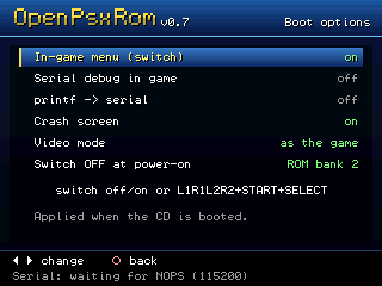
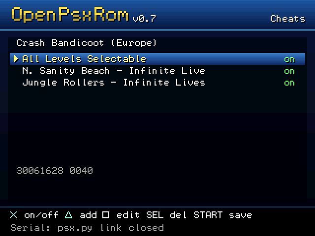
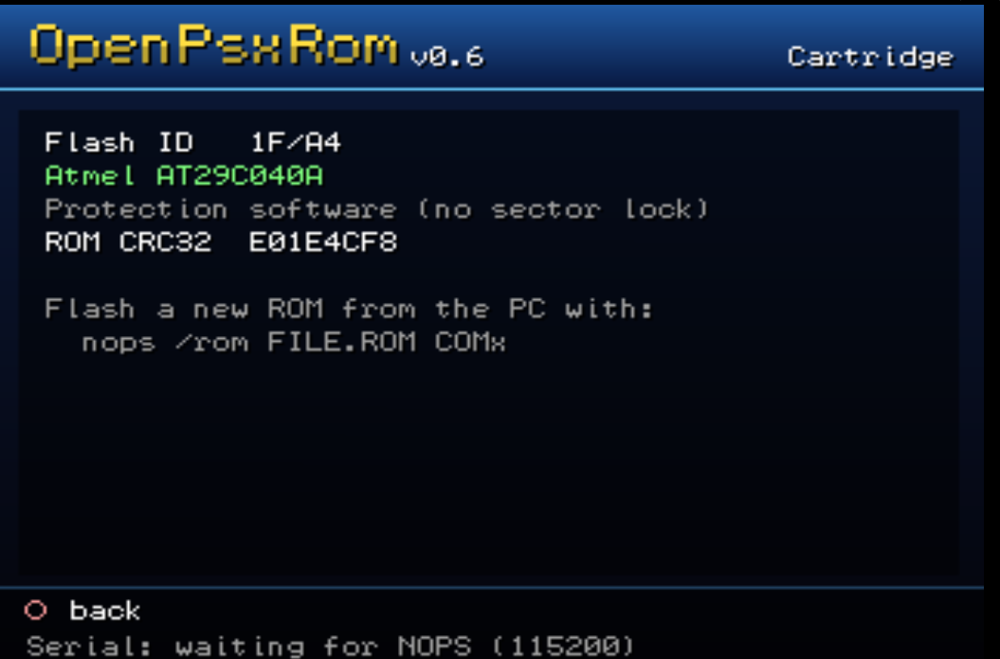

Using the menu
==============

.. image:: menu.png
   :width: 480

Controls: |updown| move, cross select or change, circle back. The bottom line shows the serial
status (*waiting for NOPS (115200)*, last command, transfer progress).

.. |updown| unicode:: U+25B2 U+25BC

Boot CD
   Starts the disc: reads ``SYSTEM.CNF``, applies its kernel configuration (``SetConf``), installs
   the resident core if an option needs it, loads and starts the executable.

Unlock drive + boot CD
   Unlocks the drive for burned discs (no modchip), then boots.

Restart
   Restarts the console, as the reset button.

Buttons are debounced (a release counts after 3 frames without the button), so a contact bounce
or a failed pad read no longer gives a second press.

Boot options
------------

.. list-table::
   :header-rows: 1
   :widths: 30 70

   * - Option
     - Effect
   * - In-game menu (switch)
     - Xplorer switch off then on, or L1+R1+L2+R2+START+SELECT held on pad 1, while a game runs
       opens the in-game menu.
   * - Serial debug in game
     - ``nops`` commands work while the game runs (dump, upload, halt, breakpoints).
   * - printf -> serial
     - Game and BIOS printf output goes to the serial port.
   * - Crash screen
     - Registers on screen and on the serial port if the game crashes.
   * - Video mode
     - *as the game*, *force PAL (50 Hz)* or *force NTSC (60 Hz)*, for imports.
   * - Switch OFF at power-on
     - *bypass*, *ROM bank 2* or *ROM bank 3*; only banks holding a firmware are offered. Stored in
       the cartridge, used at power-on.

The first five options apply when a CD is booted from the menu; the last one is saved in the flash
when leaving the screen. The menu itself is displayed in PAL or NTSC from the BIOS region letter.

Cheats
------

GameShark codes (address + value), each one on/off, stored in the flash. The resident core applies
the enabled codes on every interrupt while the game runs. Supported code types: 80 (16-bit write),
30 (8-bit write), 10/11/20/21 (increment/decrement), D0-D3/E0-E3 (conditions on the next code), 50
(serial repeater).

.. _cheat-database:

Codes from a cheat database
~~~~~~~~~~~~~~~~~~~~~~~~~~~

``tools/cheats.py`` picks codes on the PC from a database in DuckStation's format (its
``resources/cheats.zip``, a folder of ``SERIAL.cht`` files, or one ``.cht``) and writes them to the
cartridge over the serial port; the Cheats list shows them at once:

.. code-block:: sh

   python tools/cheats.py --db cheats.zip search "crash bandicoot"
   python tools/cheats.py --db cheats.zip list SCES-00344        # numbered cheats
   python tools/cheats.py --db cheats.zip send SCES-00344 1 3 4  # or: all; --append, --off
   python tools/cheats.py show                                   # what the cartridge holds
   python tools/cheats.py clear

The cartridge keeps the game's title and one list of up to 96 code lines, grouped by cheat with
its name (31 characters); the Cheats screen shows one line per cheat (cross turns all its code
lines on or off) and, at the bottom, the codes of the selected one. The core applies the enabled
codes whatever the game: send the codes of the game about to be played. A whole database does not fit in a cartridge
(DuckStation's: about 4100 games, 1.7 MB in a compact form, 400-560 KB compressed), hence the
choice on the PC. Codes that need a value chosen (``00??``) or use a type the core does not handle
(``C0``/``C2``, ``00``...) are listed but not sent. ``PSX_CHEATDB`` can hold the database path.

In-game menu
------------

With the option on, switching the Xplorer switch off then on while a game runs freezes the game and
shows a menu drawn over it: resume, cheats on/off, code finder (search a value in the game RAM,
change it in the game, search again among the candidates, then turn a result into a cheat).

The same menu opens with L1+R1+L2+R2+START+SELECT held together on pad 1. The resident core reads
the pad itself on one vblank in eight, only while the controller/memory card port is idle (never in
the middle of the game's own transfer, so a memory card save is never cut), and puts the game's
port settings back. Like the switch, it needs the game to keep its interrupts on.

Tools
-----

.. image:: tools.png
   :width: 480

CD browser
   Lists the disc; runs an ``.EXE``, flashes a ``.ROM`` (bank chosen as for ``/rom``), plays an
   ``.STR`` video.
CD audio player
   Plays audio tracks.
VRAM viewer
   Shows the whole video memory, scrollable.
Memory cards
   Two panes: the memory card (left) and the saves kept in the cartridge (right), with animated
   icons; copy, delete, free blocks. Writes are verified frame by frame. A deleted save whose
   blocks are all still there is listed (dimmed, "deleted"): X restores it.
Controller test
   Buttons and analog sticks of both pads (digital pad, DualShock, mouse...), and the raw bytes
   the pad answered.

   .. image:: controller-test.png
      :width: 480

Hex editor
   RAM and cartridge viewer.
Cartridge
   The flash chip (ID, name, protection), then what each bank holds (OpenPsxRom, Unirom, Caetla,
   Xplorer... or the header text, or empty), its CRC, which one the switch starts, and the switch
   position with the switch-off setting.

Every entry of the main menu but *Boot CD*, *Boot options*, *Tools* and *About*, and every tool, can
be left out of a custom build (:ref:`custom-builds`).
