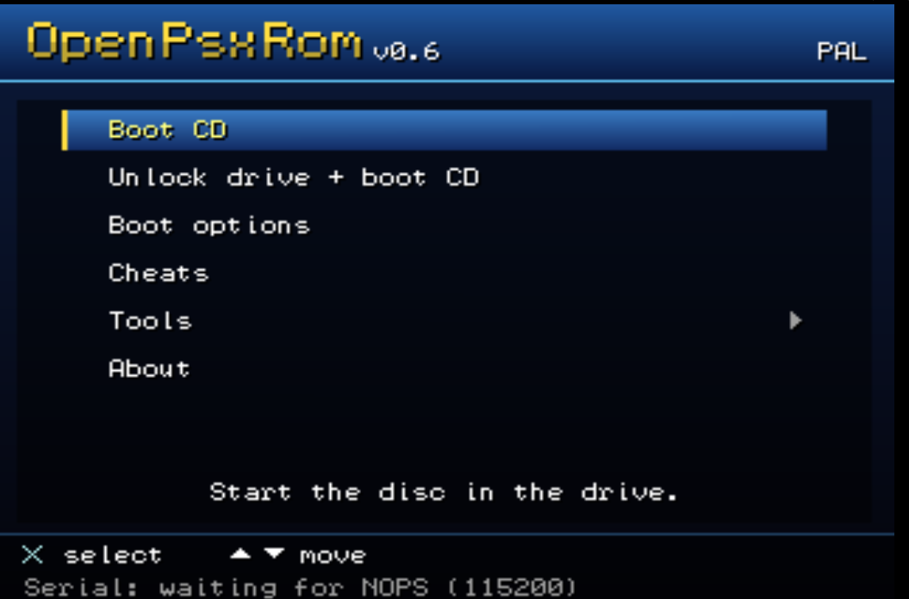
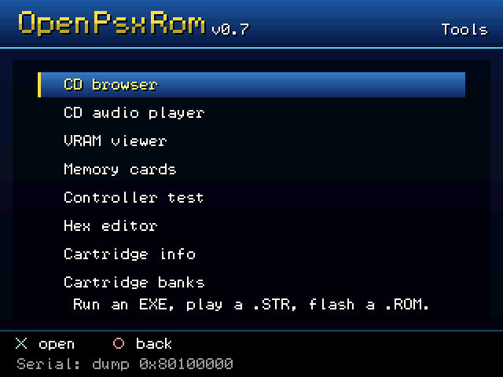

Using the menu
==============

Controls: |updown| move, cross select or change, circle back. The bottom line shows the serial
status (*waiting for NOPS (115200)*, last command, transfer progress).

.. |updown| unicode:: U+25B2 U+25BC

Boot CD
   Starts the disc: reads ``SYSTEM.CNF``, applies its kernel configuration (``SetConf``), installs
   the resident core if an option needs it, loads and starts the executable.

Unlock drive + boot CD
   Unlocks the drive for burned discs (no modchip), then boots.

Boot options
------------

.. image:: boot-options.png
   :width: 480

.. list-table::
   :header-rows: 1
   :widths: 30 70

   * - Option
     - Effect
   * - In-game menu (switch)
     - Xplorer switch off then on while a game runs opens the in-game menu.
   * - Serial debug in game
     - ``nops`` commands work while the game runs (dump, upload, halt, breakpoints).
   * - printf -> serial
     - Game and BIOS printf output goes to the serial port.
   * - Crash screen
     - Registers on screen and on the serial port if the game crashes.
   * - Video mode
     - *as the game*, *force PAL (50 Hz)* or *force NTSC (60 Hz)*, for imports.
   * - Switch OFF at power-on
     - *bypass*, *ROM bank 2* or *ROM bank 3*; only banks holding a firmware are offered. Stored in
       the cartridge, used at power-on.

The first five options apply when a CD is booted from the menu; the last one is saved in the flash
when leaving the screen. The menu itself is displayed in PAL or NTSC from the BIOS region letter.

Cheats
------

GameShark codes (address + value), each one on/off, stored in the flash. The resident core applies
the enabled codes on every interrupt while the game runs. Supported code types: 80 (16-bit write),
30 (8-bit write), 10/11/20/21 (increment/decrement), D0-D3/E0-E3 (conditions on the next code), 50
(serial repeater).

In-game menu
------------

With the option on, switching the Xplorer switch off then on while a game runs freezes the game and
shows a menu drawn over it: resume, cheats on/off, code finder (search a value in the game RAM,
change it in the game, search again among the candidates, then turn a result into a cheat).

Tools
-----

CD browser
   Lists the disc; runs an ``.EXE``, flashes a ``.ROM`` (bank chosen as for ``/rom``), plays an
   ``.STR`` video.
CD audio player
   Plays audio tracks.
VRAM viewer
   Shows the whole video memory, scrollable.
Memory cards
   Two panes: the memory card (left) and the saves kept in the cartridge (right), with animated
   icons; copy, delete, free blocks. Writes are verified frame by frame.
Controller test
   Buttons and analog sticks of both pads (digital pad, DualShock, mouse...).
Hex editor
   RAM and cartridge viewer.
Cartridge info
   Flash chip(s), IDs, protection, ROM CRC.

.. image:: cartridge.png
   :width: 480
